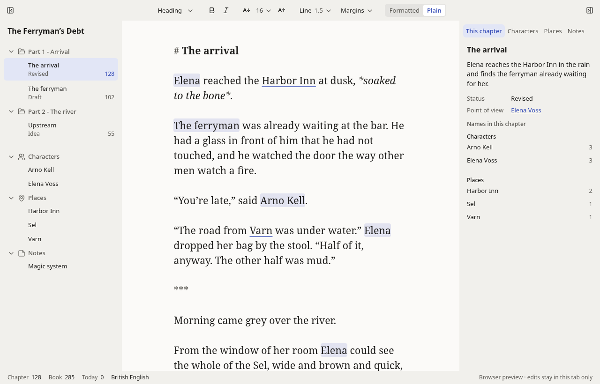
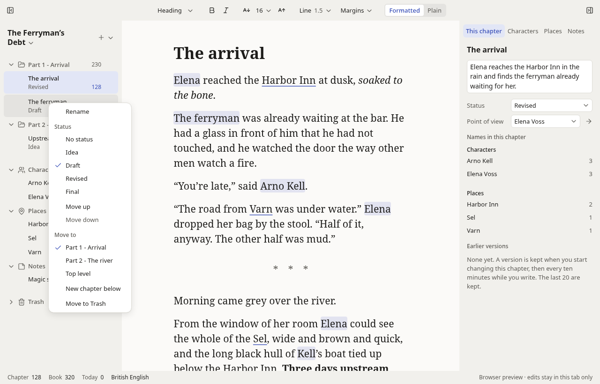
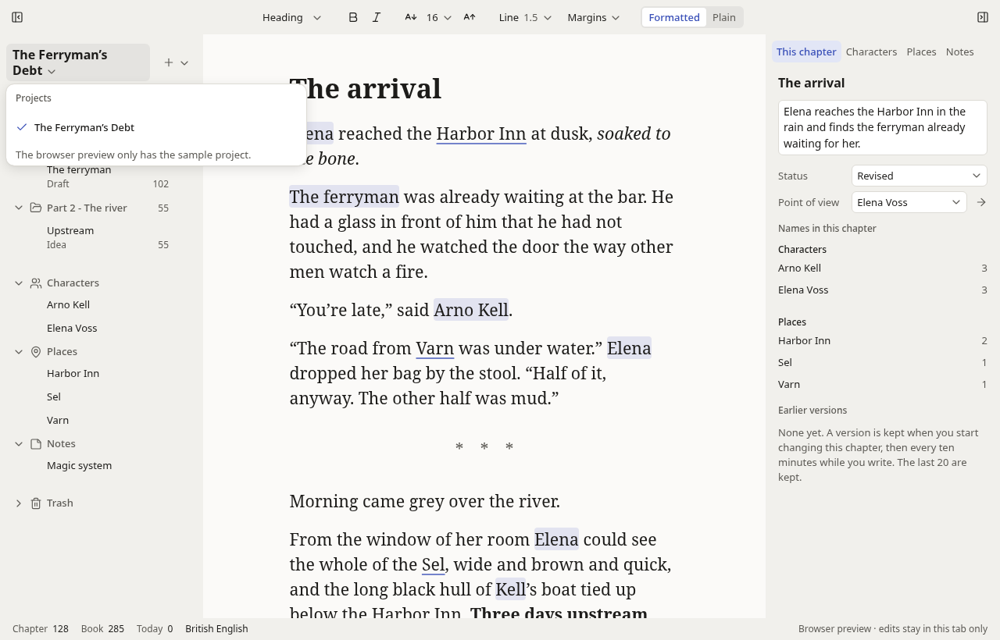
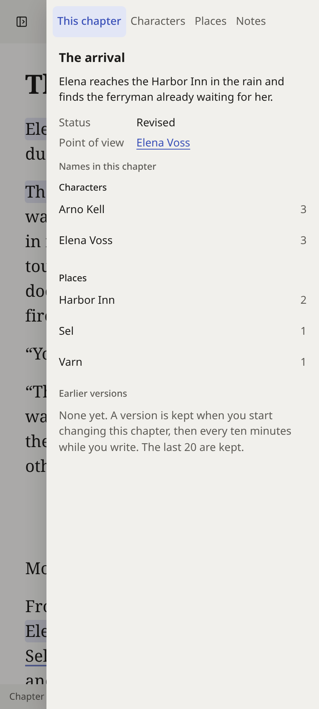

# Writing Tool

A writing app for novels, in the spirit of Scrivener and novelWriter: a binder of parts and chapters, the chapter in the middle, an inspector with character and place sheets. Chapters are plain Markdown files. The design and the plan are in [Writing App — Development Guide.md](Writing%20App%20—%20Development%20Guide.md).

Phase 1 of the guide, the writing core, is built: the desktop app (tested on Linux) and the Android app, reading and writing project folders on the device. Cloud sync, spelling and export come in later phases.

## Download

The website, **[maxgreat.github.io/writtingTool](https://maxgreat.github.io/writtingTool/)**, has these downloads too, with screenshots and the same install notes.

Every push to `main` that changes the app builds it for each platform and publishes the files as a [release](https://github.com/maxgreat/writtingTool/releases). These links always get the newest build:

| Platform | Download |
| --- | --- |
| Windows 10 and 11 | [Writing-Tool-windows-x64-setup.exe](https://github.com/maxgreat/writtingTool/releases/latest/download/Writing-Tool-windows-x64-setup.exe) |
| macOS, Apple silicon and Intel | [Writing-Tool-macos-universal.dmg](https://github.com/maxgreat/writtingTool/releases/latest/download/Writing-Tool-macos-universal.dmg) |
| Linux | [AppImage](https://github.com/maxgreat/writtingTool/releases/latest/download/Writing-Tool-linux-x86_64.AppImage), [.deb](https://github.com/maxgreat/writtingTool/releases/latest/download/Writing-Tool-linux-amd64.deb) (Debian, Ubuntu) or [.rpm](https://github.com/maxgreat/writtingTool/releases/latest/download/Writing-Tool-linux-x86_64.rpm) (Fedora, openSUSE) |
| Android, 64-bit ARM phones | [Writing-Tool-android-arm64.apk](https://github.com/maxgreat/writtingTool/releases/latest/download/Writing-Tool-android-arm64.apk) |

The apps are not code-signed yet, so Windows and macOS warn before the first launch:

- **Windows:** run the setup file. If SmartScreen says "Windows protected your PC", choose **More info**, then **Run anyway**. It installs for your user only, without admin rights.
- **macOS:** open the .dmg and drag Writing Tool to Applications. The first time you open it, macOS says it can't verify the app: open **System Settings → Privacy & Security** and choose **Open Anyway**.
- **Linux:** make the AppImage executable and run it (`chmod +x Writing-Tool-linux-x86_64.AppImage`, then `./Writing-Tool-linux-x86_64.AppImage`), or install a package with `sudo apt install ./Writing-Tool-linux-amd64.deb` or `sudo dnf install ./Writing-Tool-linux-x86_64.rpm`. The app needs WebKitGTK 4.1, which current distributions have.
- **Android:** open the APK on the phone and allow your browser to install apps when asked. Later builds install over it and keep your projects.

## Screenshots

These are refreshed with every push, so they always show the app as it is on `main`. All of them are in [docs/screenshots/](docs/screenshots/).


| Dark theme | Plain mode |
| --- | --- |
|  |  |

| Binder menu | Trash |
| --- | --- |
|  |  |

| Projects |
| --- |
|  |

| Phone | Binder | Inspector |
| --- | --- | --- |
|  |  |  |

| Projects on a phone | Android (the app on the emulator) |
| --- | --- |
|  |  |

The desktop and phone-size pictures come from `npm run screenshots`, which opens the interface on the sample project in a headless Chromium-based browser (hence "Browser preview" in the status bar). The Android one is the real app, taken on the emulator during the check that runs before each push.

## Run it

You need Node.js 22 or newer, the Rust toolchain, and [Tauri's system packages](https://v2.tauri.app/start/prerequisites/) (on Linux: WebKitGTK 4.1, GTK 3, libsoup 3).

```sh
npm install
npm run tauri dev      # the desktop app
npm run dev            # the interface alone in a browser, on a sample project kept in memory
```

On first launch the app installs a sample project in its data folder (`~/.local/share/io.github.maxgreat.writingtool/projects/MyNovel` on Linux) and opens it. The project title at the top of the binder opens the Projects view: the projects on this device, a new project (created in that same folder), and on desktop "Open folder…", which opens any folder that holds a `project.json` or a `manuscript/` folder.

## Test it

```sh
npm test                          # Markdown round trip, name matcher, project model, editors
npm run typecheck
cd src-tauri && cargo test        # project folder, atomic saves, path checks
npm run screenshots               # retakes the pictures in docs/screenshots (needs Chromium, Chrome, Brave or Edge)
.githooks/verify-launch           # builds the app from HEAD and checks that it starts and opens a chapter
```

`git push` runs the last one on what it pushes, after checking that the critic approved every commit (see [CLAUDE.md](CLAUDE.md)).

## Layout

| Path | What it holds |
| --- | --- |
| `src/core/` | Everything that is not drawn: the project model, the name matcher, Markdown and caret mapping, autosave, the two editors |
| `src/ui/` | The interface: binder, inspector, formatting bar, status bar, Projects view, design tokens |
| `src-tauri/` | The Rust core: opens and creates projects, returns their files, writes chapters atomically and keeps their earlier versions, and makes binder changes as a whole or not at all. `gen/android/` is the Android project |
| `src-tauri/icons/source/` | The app icon's source. `npx tauri icon src-tauri/icons/source/icon.json` makes every size from it, including Android's launcher icon (the drawing sits in the middle of `app-icon-fg.png` so round launcher masks don't crop it) |
| `sample-project/MyNovel/` | The sample project, bundled into the app and used by the tests |
| `scripts/screenshots.mjs` | Takes the screenshots in `docs/screenshots/` |
| `docs/index.html`, `docs/site.css` | The website, served by GitHub Pages from the `docs/` folder of `main`. It shows the screenshots from `docs/screenshots/`, so it stays current with each push |
| `.github/workflows/release.yml` | Builds the app for Linux, Windows, macOS and Android on each push to `main` and publishes a release. The links under [Download](#download) depend on its file names |

## What the app has, and what comes next

Built so far (phases 0 and 1 of the guide):

- The binder, the editor and the inspector, with hide buttons, resizable panels, focus mode, a phone layout, and light and dark themes. On phones the panels also slide in with a swipe from the screen edge (on Android with gesture navigation, from the middle of the edge: above and below it the edge stays the system's Back gesture), and the formatting bar docks above the on-screen keyboard while you type.
- Projects: the project title opens the list of projects on this device, to switch to another or create one with its title and language. On desktop, "Open folder…" opens a project folder from anywhere, and the ones opened recently are listed too.
- Binder editing: a menu on each chapter and part (right-click, long-press, or its ⋯ button) to rename, set a status, move, add and trash; drag to reorder with a mouse or pen; part word counts; a Trash with Restore. Chapter files are renumbered to follow the binder order.
- This chapter's synopsis, status and point of view, edited in the inspector.
- Two editing modes on the same Markdown: Formatted (Tiptap) and Plain (CodeMirror 6). Switching keeps the caret in place, and the chapter files round-trip byte for byte.
- Character and place names highlighted as you type: whole words, longest match wins, apostrophes and accents handled, and case rules set per alias. Clicking a name opens its sheet.
- Autosave about a second after typing stops, with atomic writes, and word counts for the chapter, the book and today.
- Earlier versions of each chapter: the last 20 are kept in `snapshots/` (one at most every ten minutes of editing) and can be restored from the inspector.

Still to build, following the guide's phases:

- Dropbox sync, presence badges and conflict merging
- Spelling (spellbook with Hunspell dictionaries) and grammar
- Export: the Typst PDF preview, then EPUB, Word and Markdown
- Testing the Windows and macOS builds on real machines (CI builds them, but only the Linux and Android apps have been run so far), and code-signing them
- Editing sheets, and the "Possible names" list
