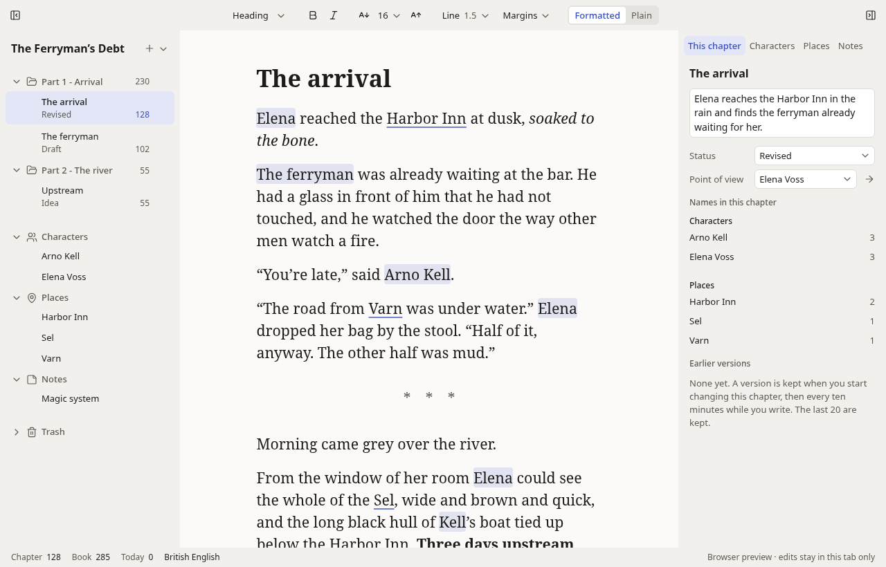
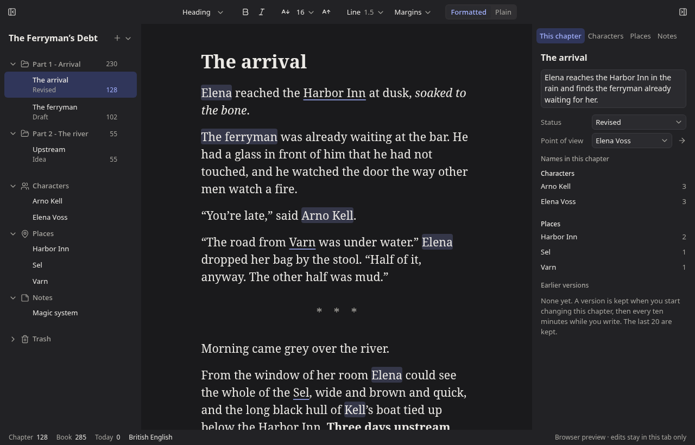
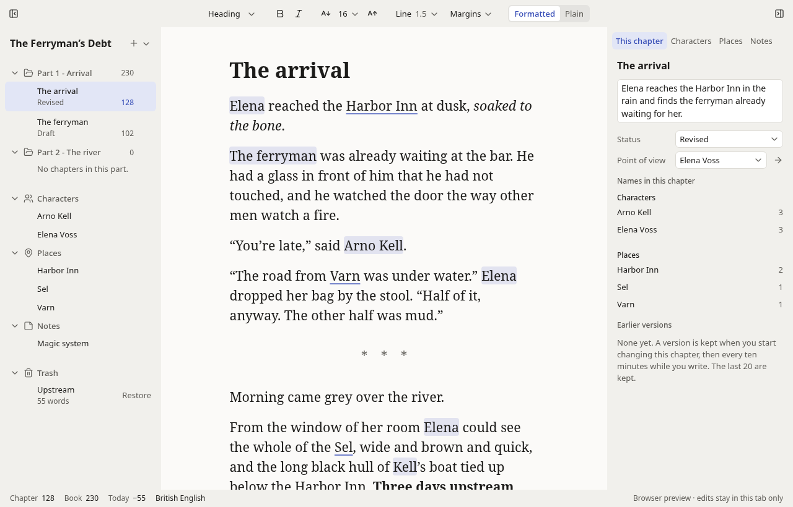
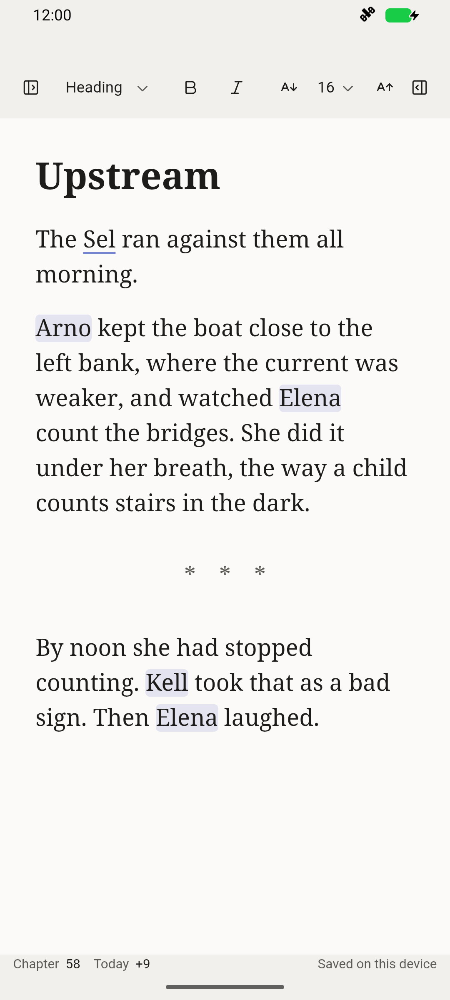

# Writing Tool

A writing app for novels, in the spirit of Scrivener and novelWriter: a binder of parts and chapters, the chapter in the middle, an inspector with character and place sheets. Chapters are plain Markdown files. The design and the plan are in [Writing App — Development Guide.md](Writing%20App%20—%20Development%20Guide.md).

This is the first prototype: the desktop app on Linux, reading and writing a local project folder.

## Screenshots

These are refreshed with every push, so they always show the app as it is on `main`. All of them are in [docs/screenshots/](docs/screenshots/).



| Dark theme | Plain mode |
| --- | --- |
|  |  |

| Binder menu | Trash |
| --- | --- |
|  |  |

| Phone | Binder | Inspector |
| --- | --- | --- |
|  |  |  |

| Android (the app on the emulator) |
| --- |
|  |

The desktop and phone-size pictures come from `npm run screenshots`, which opens the interface on the sample project in a headless Chromium-based browser (hence "Browser preview" in the status bar). The Android one is the real app, taken on the emulator during the check that runs before each push.

## Run it

You need Node.js 22 or newer, the Rust toolchain, and [Tauri's system packages](https://v2.tauri.app/start/prerequisites/) (on Linux: WebKitGTK 4.1, GTK 3, libsoup 3).

```sh
npm install
npm run tauri dev      # the desktop app
npm run dev            # the interface alone in a browser, on a sample project kept in memory
```

On first launch the app installs a sample project in its data folder (`~/.local/share/io.github.maxgreat.writingtool/projects/MyNovel` on Linux) and opens it. "Open folder…" in the binder opens any folder that holds a `project.json` or a `manuscript/` folder.

## Test it

```sh
npm test                          # Markdown round trip, name matcher, project model, editors
npm run typecheck
cd src-tauri && cargo test        # project folder, atomic saves, path checks
npm run screenshots               # retakes the pictures in docs/screenshots (needs Chromium, Chrome, Brave or Edge)
.githooks/verify-launch           # builds the app from HEAD and checks that it starts and opens a chapter
```

`git push` runs the last one on what it pushes, after checking that the critic approved every commit (see [CLAUDE.md](CLAUDE.md)).

## Layout

| Path | What it holds |
| --- | --- |
| `src/core/` | Everything that is not drawn: the project model, the name matcher, Markdown and caret mapping, autosave, the two editors |
| `src/ui/` | The interface: binder, inspector, formatting bar, status bar, design tokens |
| `src-tauri/` | The Rust core: opens the project folder, returns its files, writes chapters atomically |
| `sample-project/MyNovel/` | The sample project, bundled into the app and used by the tests |
| `scripts/screenshots.mjs` | Takes the screenshots in `docs/screenshots/` |

## What the prototype has, and what comes next

In the prototype:

- The binder, the editor and the inspector, with hide buttons, resizable panels, focus mode, a phone layout, and light and dark themes.
- Binder editing: a menu on each chapter and part (right-click, long-press, or its ⋯ button) to rename, set a status, move, add and trash; drag to reorder with a mouse or pen; part word counts; a Trash with Restore. Chapter files are renumbered to follow the binder order.
- This chapter's synopsis, status and point of view, edited in the inspector.
- Two editing modes on the same Markdown: Formatted (Tiptap) and Plain (CodeMirror 6). Switching keeps the caret in place, and the chapter files round-trip byte for byte.
- Character and place names highlighted as you type: whole words, longest match wins, apostrophes and accents handled, and case rules set per alias. Clicking a name opens its sheet.
- Autosave about a second after typing stops, with atomic writes.

Still to build, following the guide's phases:

- Dropbox sync, presence badges and conflict merging
- Spelling (spellbook with Hunspell dictionaries) and grammar
- Export: the Typst PDF preview, then EPUB, Word and Markdown
- Android and Windows builds, and CI
- Editing sheets, and the "Possible names" list
