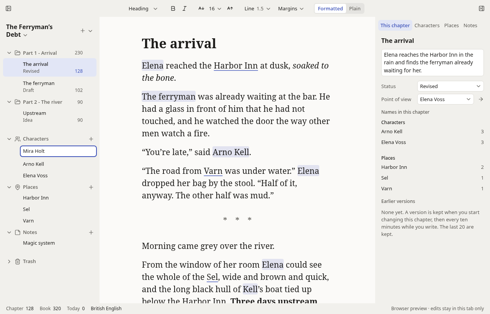
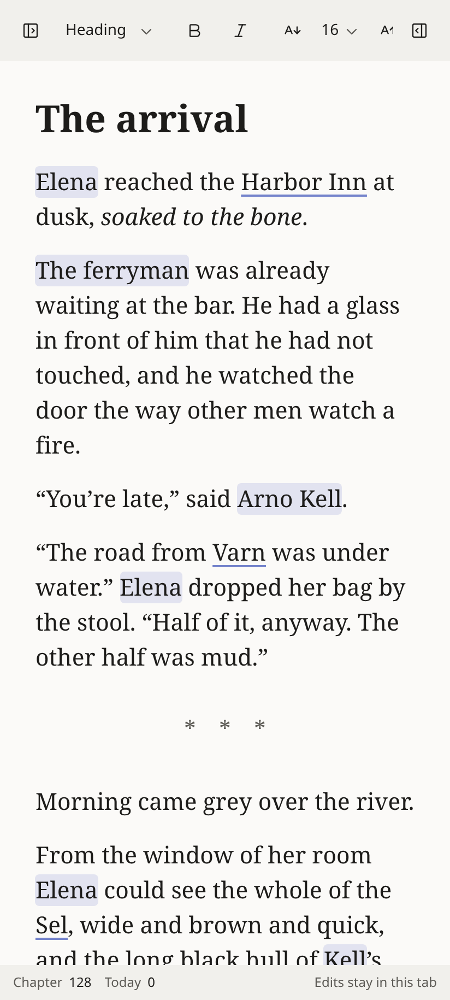
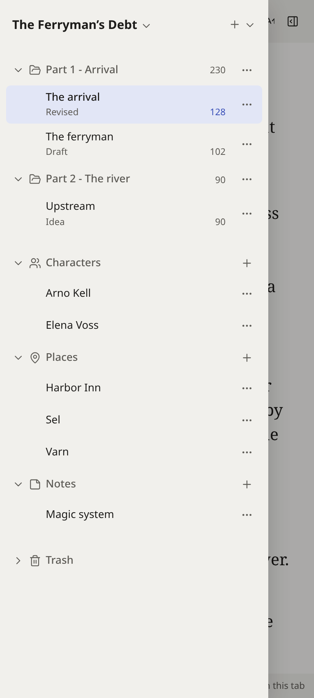
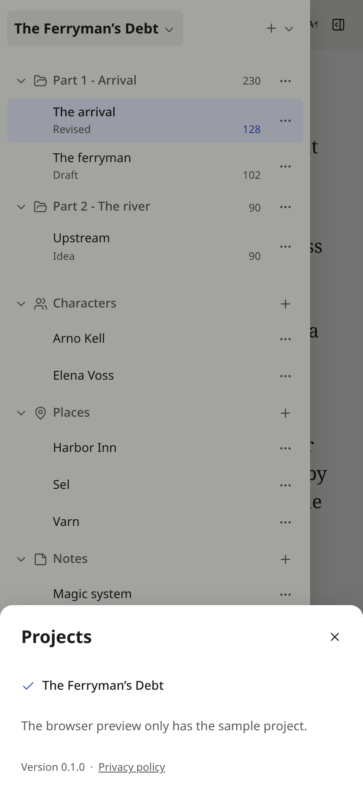
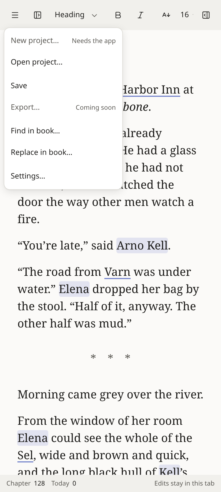

# Writing Tool

A writing app for novels, in the spirit of Scrivener and novelWriter: a binder of parts and chapters, the chapter in the middle, an inspector with character and place sheets. Chapters are plain Markdown files. The design and the plan are in [Writing App — Development Guide.md](Writing%20App%20—%20Development%20Guide.md).

Phase 1 of the guide, the writing core, is built, with sheet forms from phase 2, name detection from phase 3 and the spelling check from phase 4: the desktop app (tested on Linux) and the Android app, reading and writing project folders on the device. Grammar, cloud sync and export come in later phases.

## Download

The website, **[maxgreat.github.io/writtingTool](https://maxgreat.github.io/writtingTool/)**, has these downloads too, with screenshots and the same install notes.

Every push to `main` that changes the app builds it for each platform and publishes the files as a [release](https://github.com/maxgreat/writtingTool/releases). These links always get the newest build:

| Platform | Download |
| --- | --- |
| Windows 10 and 11 | [Writing-Tool-windows-x64-setup.exe](https://github.com/maxgreat/writtingTool/releases/latest/download/Writing-Tool-windows-x64-setup.exe) |
| macOS, Apple silicon and Intel | [Writing-Tool-macos-universal.dmg](https://github.com/maxgreat/writtingTool/releases/latest/download/Writing-Tool-macos-universal.dmg) |
| Linux | [AppImage](https://github.com/maxgreat/writtingTool/releases/latest/download/Writing-Tool-linux-x86_64.AppImage), [.deb](https://github.com/maxgreat/writtingTool/releases/latest/download/Writing-Tool-linux-amd64.deb) (Debian, Ubuntu) or [.rpm](https://github.com/maxgreat/writtingTool/releases/latest/download/Writing-Tool-linux-x86_64.rpm) (Fedora, openSUSE) |
| Android, 64-bit ARM phones | [Writing-Tool-android-arm64.apk](https://github.com/maxgreat/writtingTool/releases/latest/download/Writing-Tool-android-arm64.apk) |

The apps are not code-signed yet, so Windows and macOS warn before the first launch:

- **Windows:** run the setup file. If SmartScreen says "Windows protected your PC", choose **More info**, then **Run anyway**. It installs for your user only, without admin rights.
- **macOS:** open the .dmg and drag Writing Tool to Applications. The first time you open it, macOS says it can't verify the app: open **System Settings → Privacy & Security** and choose **Open Anyway**.
- **Linux:** make the AppImage executable and run it (`chmod +x Writing-Tool-linux-x86_64.AppImage`, then `./Writing-Tool-linux-x86_64.AppImage`), or install a package with `sudo apt install ./Writing-Tool-linux-amd64.deb` or `sudo dnf install ./Writing-Tool-linux-x86_64.rpm`. The app needs WebKitGTK 4.1, which current distributions have.
- **Android:** open the APK on the phone and allow your browser to install apps when asked. Later builds install over it and keep your projects.

## Screenshots

These are refreshed with every push, so they always show the app as it is on `main`. All of them are in [docs/screenshots/](docs/screenshots/).


| Dark theme | Plain mode |
| --- | --- |
|  |  |

| Binder menu | Trash |
| --- | --- |
|  |  |

| Projects | Main menu |
| --- | --- |
|  |  |

| A new character | A character's menu |
| --- | --- |
|  |  |

| A character's sheet | Editing it |
| --- | --- |
|  |  |

| Opened from a name in the text | A possible name in the text |
| --- | --- |
|  |  |

| Possible names in the inspector | Any word as a name |
| --- | --- |
|  |  |

| A misspelled word | |
| --- | --- |
| ![The chapter The arrival after a sentence was typed at the end of a paragraph: "The ferryman's skif was moored at the jety." Skif and jety each have a red wavy underline, unlike the tinted names and the straight underline of places. A right-click on skif opened a small menu titled with the word in quotes: its corrections in bold, best first (skiff, skid, skit, ski, skim, skin), then, after a gap, Add to project dictionary and Add to my dictionary, then Add to Characters and Add to Places, as a misspelled word may be a name. The desktop app puts the same choices above Cut, Copy and Paste in the system's menu, and a tap on the word opens this menu on a touch screen](docs/screenshots/desktop-spelling-menu.png) | |

| Phone | Binder | Inspector |
| --- | --- | --- |
|  |  |  |

| Projects on a phone | Main menu on a phone | Android (the app on the emulator) |
| --- | --- | --- |
|  |  |  |

The desktop and phone-size pictures come from `npm run screenshots`, which opens the interface on the sample project in a headless Chromium-based browser (hence "Browser preview" in the status bar). The Android one is the real app, taken on the emulator during the check that runs before each push.

## Run it

You need Node.js 22 or newer, the Rust toolchain, and [Tauri's system packages](https://v2.tauri.app/start/prerequisites/) (on Linux: WebKitGTK 4.1, GTK 3, libsoup 3).

```sh
npm install
npm run tauri dev      # the desktop app
npm run dev            # the interface alone in a browser, on a sample project kept in memory
```

On first launch the app installs a sample project in its data folder (`~/.local/share/io.github.maxgreat.writingtool/projects/MyNovel` on Linux) and opens it. The project title at the top of the binder opens the Projects view: the projects on this device, a new project (created in that same folder), and on desktop "Open folder…", which opens any folder that holds a `project.json` or a `manuscript/` folder.

## Test it

```sh
npm test                          # Markdown round trip, name matcher, project model, editors
npm run typecheck
cd src-tauri && cargo test        # project folder, atomic saves, path checks
npm run screenshots               # retakes the pictures in docs/screenshots (needs Chromium, Chrome, Brave or Edge)
.githooks/verify-launch           # builds the app from HEAD and checks that it starts and opens a chapter
```

`git push` runs the last one on what it pushes, after checking that the critic approved every commit (see [CLAUDE.md](CLAUDE.md)).

## Layout

| Path | What it holds |
| --- | --- |
| `src/core/` | Everything that is not drawn: the project model, the name matcher, Markdown and caret mapping, autosave, the two editors |
| `src/ui/` | The interface: binder, inspector, formatting bar, status bar, Projects view, design tokens |
| `src-tauri/` | The Rust core: opens and creates projects, returns their files, writes chapters atomically and keeps their earlier versions, and makes binder changes as a whole or not at all. `gen/android/` is the Android project |
| `src-tauri/icons/source/` | The app icon's source. `npx tauri icon src-tauri/icons/source/icon.json` makes every size from it, including Android's launcher icon (the drawing sits in the middle of `app-icon-fg.png` so round launcher masks don't crop it) |
| `sample-project/MyNovel/` | The sample project, bundled into the app and used by the tests |
| `scripts/screenshots.mjs` | Takes the screenshots in `docs/screenshots/` |
| `docs/index.html`, `docs/site.css` | The website, served by GitHub Pages from the `docs/` folder of `main`. It shows the screenshots from `docs/screenshots/`, so it stays current with each push |
| `docs/privacy.html` | The privacy policy, linked from the website, from the Google Play listing and from the app (the last line of the Projects view; the app may open pages of this site only). Update it before releasing anything that sends data off the device |
| `fastlane/metadata/android/en-US/` | The Google Play listing: title, descriptions, store icon, feature graphic and phone screenshots, in the layout fastlane and F-Droid read |
| `.github/workflows/release.yml` | Builds the app for Linux, Windows, macOS and Android on each push to `main` and publishes a release. The links under [Download](#download) depend on its file names |

## What the app has, and what comes next

Built so far (phases 0 and 1 of the guide, sheet forms from phase 2, name detection from phase 3, and spelling from phase 4):

- The binder, the editor and the inspector, with hide buttons, resizable panels, focus mode, a phone layout, and light and dark themes. On phones the panels also slide in with a swipe from the screen edge (on Android with gesture navigation, from the middle of the edge: above and below it the edge stays the system's Back gesture), and the formatting bar docks above the on-screen keyboard while you type.
- Projects: the project title opens the list of projects on this device, to switch to another or create one with its title and language. On desktop, "Open folder…" opens a project folder from anywhere, and the ones opened recently are listed too.
- A main menu, at the left end of the bar: New project…, Open project… (Ctrl+O, ⌘O on a Mac), Open folder… on desktop, Save (Ctrl+S), focus mode (F11) and, on desktop, Quit (Ctrl+Q). The app saves by itself a second after you stop typing; Save writes at once, and the status bar shows a check, or why it couldn't. Export… is listed, not built yet.
- On desktop, Quit and the window's close button ask first. When everything is saved the dialog says so, with Close and Cancel; when the last changes aren't written yet, it offers Save and close, Close without saving or Cancel, and if the save fails it says why, with Try again. Autosave waits while it asks.
- The app's version and a link to the [privacy policy](https://maxgreat.github.io/writtingTool/privacy.html), on the last line of the Projects view, as Google Play asks. The link opens in the system browser; if that fails, the view shows the address.
- Binder editing: a menu on each chapter and part (right-click, long-press, or its ⋯ button) to rename, set a status, move, add and trash; drag to reorder with a mouse or pen; part word counts; a Trash with Restore. Chapter files are renumbered to follow the binder order.
- This chapter's synopsis, status and point of view, edited in the inspector.
- Two editing modes on the same Markdown: Formatted (Tiptap) and Plain (CodeMirror 6). Switching keeps the caret in place, and the chapter files round-trip byte for byte.
- Character and place names highlighted as you type: whole words, longest match wins, apostrophes and accents handled, and case rules set per alias. Clicking a name opens its sheet; a name shared by two sheets (two characters called Marie) has a dashed highlight and asks which one.
- Ignore here, for a name that isn't the character there (the character Rose, not a rose on the table). A sheet opened from a name in the text shows the sentence it was clicked in, with Ignore here: the highlight goes at once, and Highlight again in the same place undoes it. The choice for a shared name offers it too, for when the name means neither sheet. It is remembered in `project.json` by its sentence, so the chapter file stays as it is, and each sheet lists its ignored mentions, each with Highlight again.
- Possible names, marked in the text with a faint dotted underline: capitalized words that aren't at the start of a sentence and have no sheet yet. With a dictionary for the project's language (the app has British and American English, French and Spanish), every such word that isn't a dictionary word is marked from its first use, so "River" or "Monday" isn't; without one (another language, or the browser preview), a word is marked once it is found 3 or more times in the book. Click a marked word for Add to Characters or Add to Places (or any other type that holds names), which makes the sheet and highlights the word everywhere at once, or Not a name, which takes its marks away everywhere, with Undo in the same place. This chapter, in the inspector, lists the chapter's possible names too, with how often each is found in the book. Focus mode hides the marks, and words marked as not names are kept in `project.json`.
- Any word or phrase added as a name by hand, for names that are also ordinary words ("Rose", "Will") and so are never marked as possible names. Right-click a word, or a selection, to add it to Characters or Places (or any other type that holds names); in the desktop app these items sit above Cut, Copy and Paste in the system's menu, and a right-click on a name offers to open its sheet. On a phone or tablet, select the text with a long-press and tap Add as name, just below it. The new name is highlighted everywhere at once. Focus mode leaves this out.
- Spelling checked as you write, offline, with the Hunspell dictionaries of the project's language (British and American English, French, Spanish) in the app's Rust core. Misspelled words get a wavy underline a moment after you stop typing; character and place names, possible names and words in capitals are never marked. Right-click one (on a phone or tablet, tap it) for corrections, Add to project dictionary (the project's `dictionary.txt`, which travels with the project) or Add to my dictionary (every project on this device). Focus mode hides the marks. The browser preview checks spelling too, through `npm run dev`'s server.
- Every sheet but notes lists the chapters that mention it, under their parts, with how many times; clicking one opens that chapter.
- Sheets made and edited in the app. "New character" (or place, note) at the top of a type's list in the inspector asks for the name, makes `sheets/<type>/<name>.md` and opens its form. A sheet's Edit shows its form: the name, other names (each can match in any case, so the alias "the ferryman" also finds "The ferryman"), the type's fields (characters have a role and an age, places a type; `fields` in a sheet type in `project.json` changes them) plus any you add, and the notes in Markdown. Changes save as you go; a name is saved when you leave its field, and the highlights follow at once. On phones, the name preview has Edit too, which opens the form in the inspector. A sheet whose header can't be read says so and stays read-only.
- Autosave about a second after typing stops, with atomic writes, and word counts for the chapter, the book and today.
- Earlier versions of each chapter: the last 20 are kept in `snapshots/` (one at most every ten minutes of editing) and can be restored from the inspector.

Still to build, following the guide's phases:

- Dropbox sync, presence badges and conflict merging
- Grammar, and typing aids (curly quotes, dashes, French spacing)
- Export: the Typst PDF preview, then EPUB, Word and Markdown
- Testing the Windows and macOS builds on real machines (CI builds them, but only the Linux and Android apps have been run so far), and code-signing them
